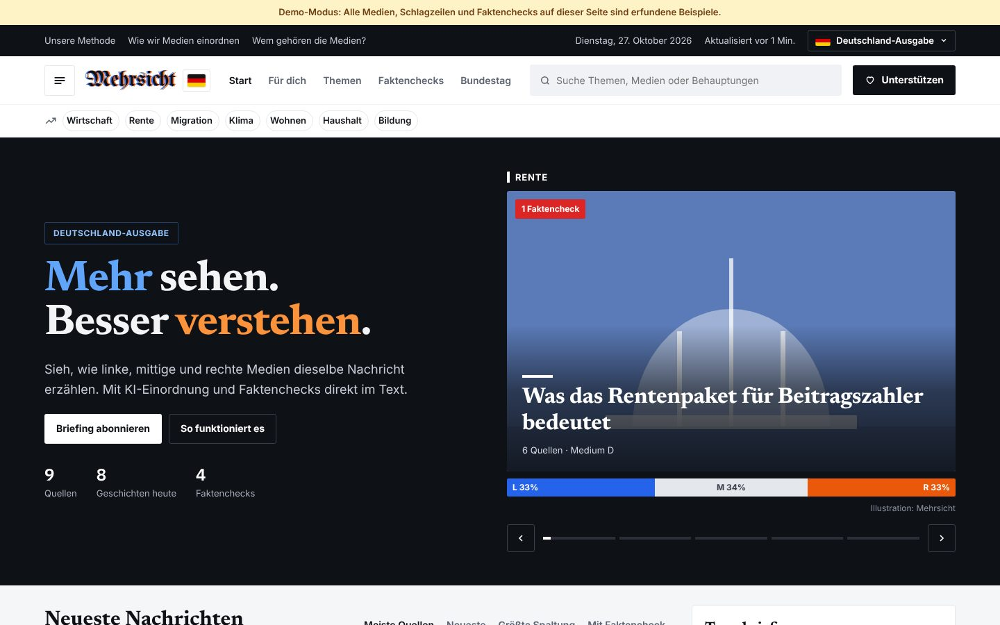
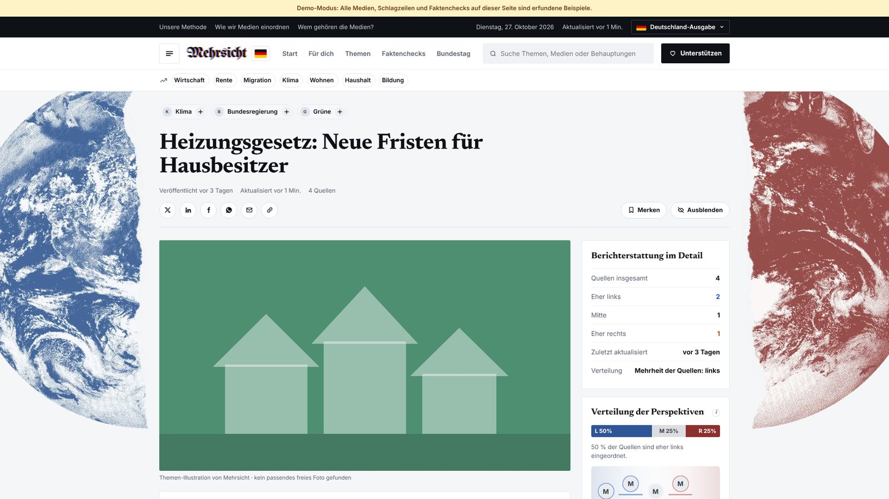
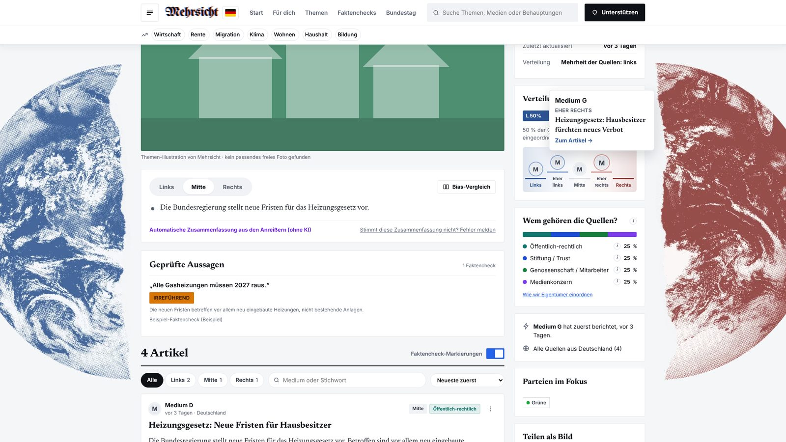
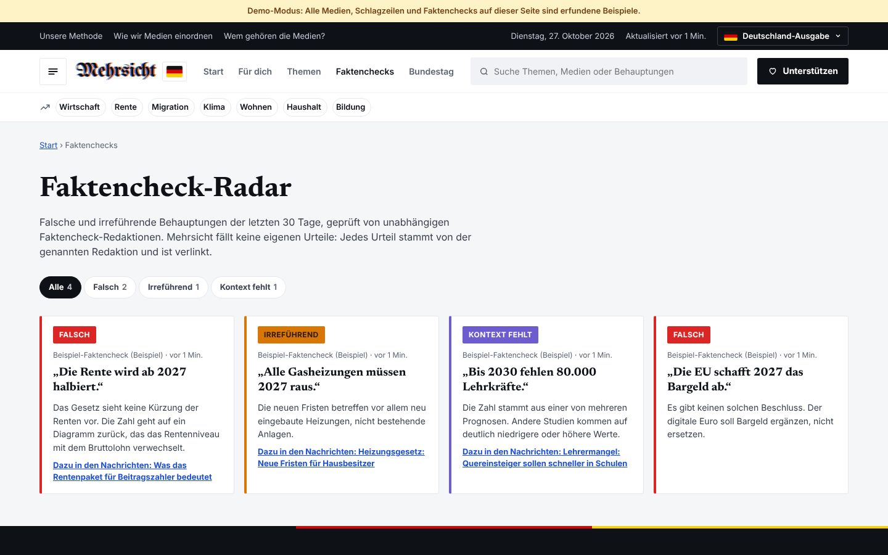
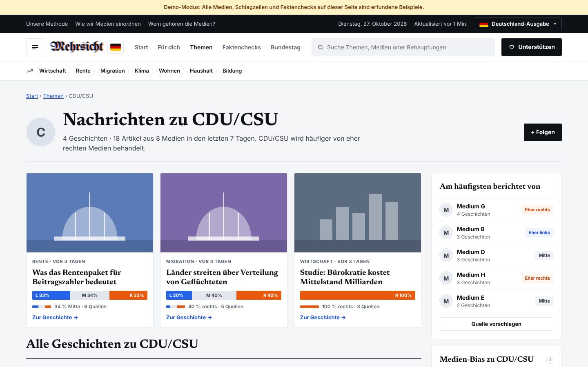
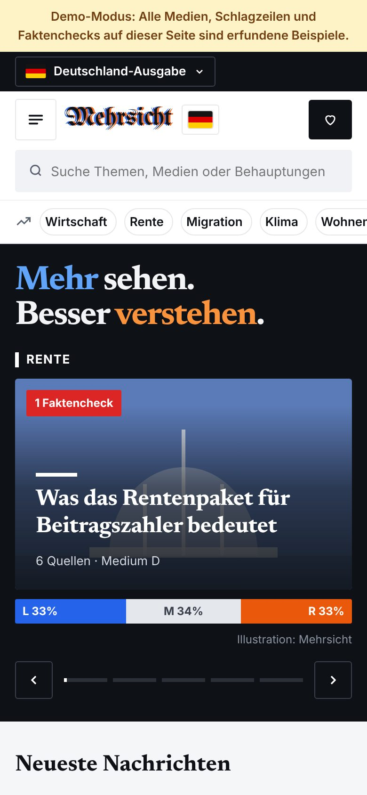
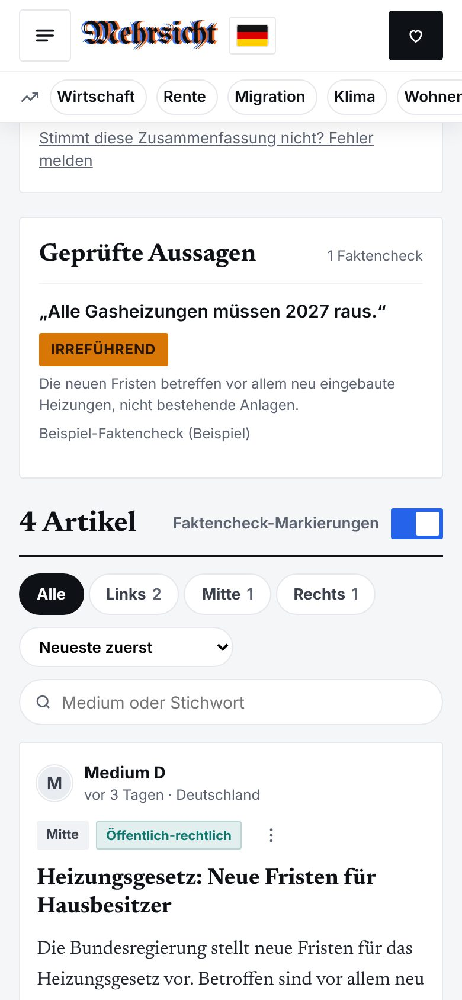
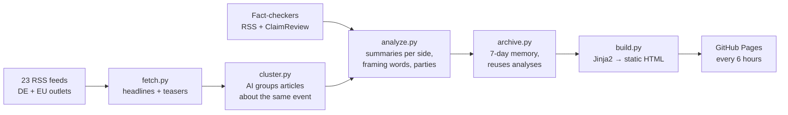

<h1 align="center">Mehrsicht</h1>
<p align="center"><b>Mehr sehen. Besser verstehen.</b><br>
News from Germany and Europe, seen from every side – an AI-powered media comparison with built-in fact-checks.</p>

<p align="center">
  
  
  
  
  
</p>



> Screenshots show the built-in **demo mode**: every outlet, headline and fact-check in them is invented.

## The idea

The same event reads very differently in *taz*, *FAZ* and *WELT*. Most people only ever see one of
those versions. **Mehrsicht** (German for "more view") collects the news from 23 German and European
outlets every few hours. It groups articles about the same event and shows, side by side, how left,
centre and right media tell the story. It also underlines claims that professional fact-checkers have
rated as false.

It is a fully automated pipeline: **RSS → AI clustering → AI framing analysis → fact-check matching
→ static website**, running on free tiers only (no server, no database, no paid API).

## Features

**Compare perspectives**
- Every story shows its coverage split (**left / centre / right**) and a switch to read the summary from each side.
- **Bias comparison**: all three perspectives in three columns, with the words each side favours.
- Outlet logos arranged on a left-to-right scale. Hover shows the outlet's headline; a click jumps to its article.
- **Ownership** of the outlets (public broadcaster, family publisher, media group, foundation, …), **who reported first**, and the countries the sources come from.

**Fact-checks, not opinions**
- Fact-checks are pulled from real fact-checking newsrooms (CORRECTIV, tagesschau Faktenfinder, Mimikama; plus dpa, AFP, BR24 and European fact-checkers via the Google Fact Check Tools API).
- Stories that a fact-checker has examined are **picked first**. The false sentence is underlined in the article teaser, and hovering shows the verdict and source.
- Mehrsicht never decides on its own that something is false. Every verdict is linked to the newsroom that made it.

**Explore**
- **Trending bar**: topics ranked by number of outlets × recency (e<sup>−age/24h</sup>, last 72 h), with a one-click *follow*.
- Topic pages ("News about …"): top stories, the outlets covering the topic most, and the topic's media bias.
- **Für dich**: followed topics, saved and hidden stories. Everything is stored only in the visitor's browser.
- Two editions with a flag switch: 🇩🇪 Germany (Bundestag coalition calculator) and 🇪🇺 Europe (European Parliament).
- Automatically generated **share images** for Instagram / LinkedIn.
- Responsive from 360 px phones to wide screens.

| Story page | Perspectives & hover card |
|---|---|
|  |  |
| **Fact-check radar** | **Topic page** |
|  |  |

<p align="center">
  &nbsp;&nbsp;
  
</p>

## How it works



| Step | What happens | Tech |
|---|---|---|
| Fetch | Newest headlines and teasers from 23 outlets, logos, best available image | `feedparser`, `requests`, `Pillow` |
| Cluster | An LLM labels every headline with its event; labels are merged into stories (offline fallback: Jaccard + union-find) | Groq · `gpt-oss-120b` |
| Analyse | Neutral summary, bullet points per side, framing words, entities, location, parties | Groq · `gpt-oss-20b` (JSON mode) |
| Fact-check | ClaimReview data from fact-checkers' pages; the AI only *reads* the verdict when no structured data exists | Google Fact Check Tools API (optional) |
| Trends & topics | Entity topics, name merging ("Trump" → "Donald Trump"), trending score | Python |
| Build | Static site, two editions, topic pages, share images | `Jinja2`, `Playwright` |
| Deploy | Scheduled GitHub Action with a cache for the 7-day archive | GitHub Actions + Pages |

### Engineering decisions

- **Free-tier budget engineering.** Batching headlines into one clustering request, a small model for analysis, and a 7-day archive, so a story is only re-analysed when 3+ new sources appear. Automatic fallback to a second provider when the daily limit is hit.
- **Robust to messy AI output.** Every AI answer is validated and type-cleaned, and the pipeline still produces a complete site without any AI.
- **Responsible by design.** Outlet ratings are published and marked provisional, there are no own verdicts, and only headlines and short teasers are shown, always linked to the original. Press photos are used locally only; the public site uses freely licensed Wikimedia images with credits.
- **GDPR-friendly.** Self-hosted fonts, no cookies, no trackers, no accounts. Personalisation lives in `localStorage`.

## Quick start (demo, no keys needed)

```bash
git clone https://github.com/ABsynced/mehrsicht.git
cd mehrsicht
python -m venv .venv
# Windows: .venv\Scripts\Activate.ps1     macOS/Linux: source .venv/bin/activate
pip install -r requirements.txt
python -m playwright install chromium

python -m pipeline.run --offline      # invented demo news
python -m site_builder.build
python -m http.server 8000 --directory site   # open http://localhost:8000
```

**Real news:** copy `.env.example` to `.env`, add a free [Groq](https://console.groq.com) key, then run
`python -m pipeline.run --edition all`. Optional: `FACTCHECK_API_KEY` (free, Google) for more fact-checks.
The full beginner-friendly walkthrough is in **[docs/SETUP.md](docs/SETUP.md)**.

```bash
python -m pytest -q              # 25 tests, offline
python -m pipeline.check_feeds   # are all news and fact-check feeds reachable?
python -m pipeline.check_ai --live
```

## Project structure

```
config/          outlets + their lean, ownership, topics, parliament seats, fact-checkers
pipeline/        fetch · cluster · analyze · factfeeds · images · trending · archive · run
site_builder/    Jinja2 templates, CSS, vanilla JS, self-hosted fonts → site/
sharecards/      social-media image templates (rendered with Playwright)
fixtures/        invented demo outlets and headlines for offline mode
tests/           pytest suite (runs fully offline)
.github/         scheduled build + deploy to GitHub Pages
```

## Roadmap

- [ ] Weekly e-mail briefing generated from the pipeline (Brevo, double opt-in)
- [ ] More fact-checking sources for the Europe edition
- [ ] Documented, study-based outlet ratings

## About

Built by **Achraf Benhammadi**, M.A. student in *Data and Discourse Studies* at TU Darmstadt.
The project combines my interest in how discourse frames reality with hands-on AI automation.

[LinkedIn](https://www.linkedin.com/in/achrafbenhammadi) · [GitHub](https://github.com/ABsynced)

<sub>Outlet ratings are estimates, not judgements of quality. All fact-check verdicts come from the linked
fact-checking organisations. Headlines and teasers belong to their publishers.</sub>
